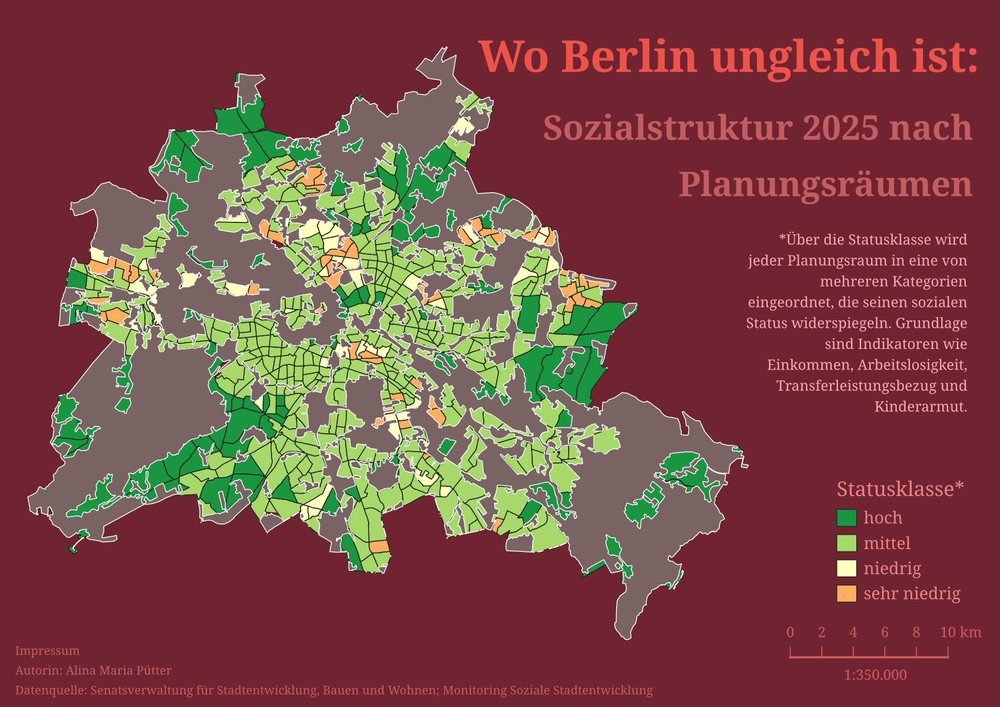
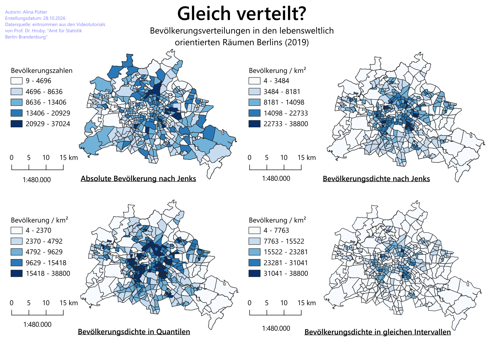
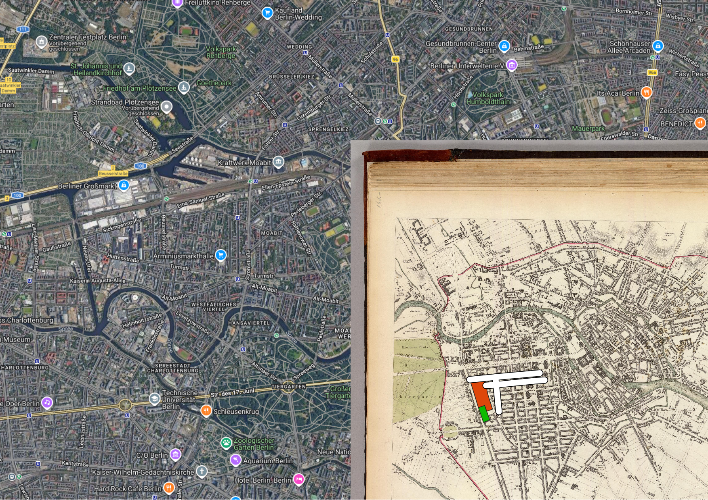
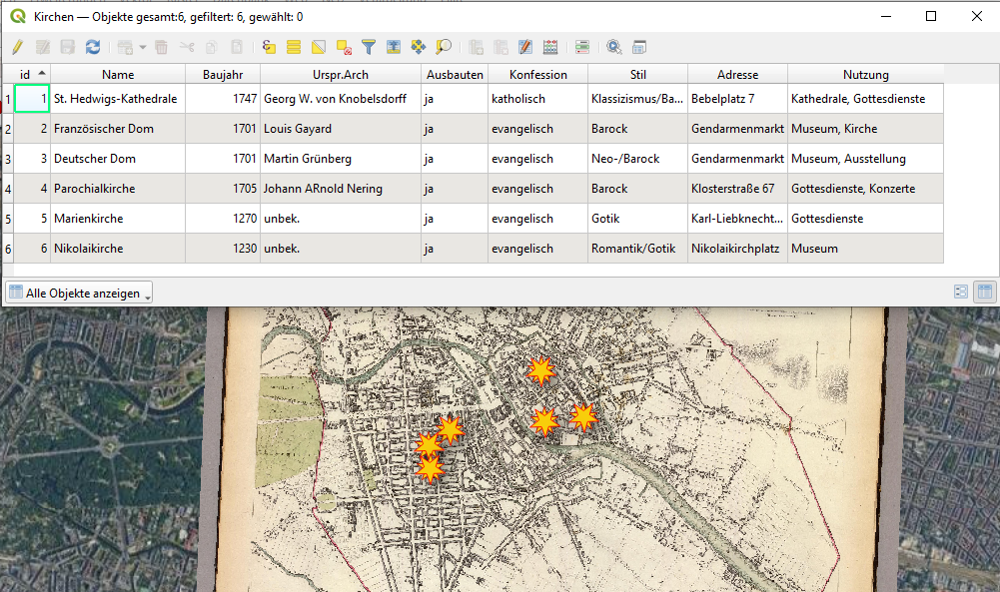
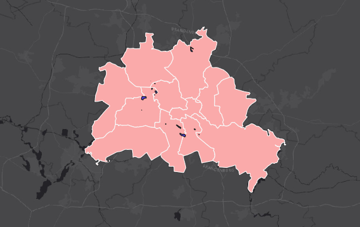
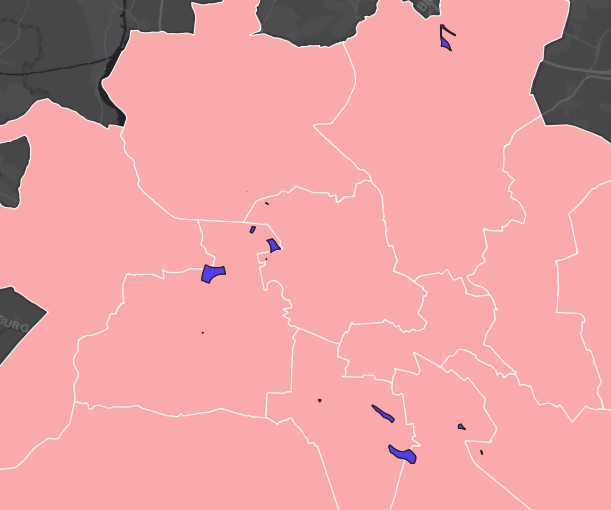

# GIS
## Einheit 0: Einführung in QGIS - Monitoring Soziale Stadtentwicklung

### Kurzbeschreibung:
Die verwendete Methode ermöglicht eine mehrdimensionale Betrachtung der sozialen Struktur Berlins, da Indikatoren wie Arbeitslosigkeit, Transferleistungsbezug und Kinderarmut miteinander kombiniert werden. Daraus folgt eine besonders deutliche Darstellung der prägnant benachteiligten Gebiete Berlins.
Aber genau durch diese Kombination können Einzelinformationen, sprich, die oben genannten Indikatoren, verloren gehen. Hier ist nicht deutlich erkennbar, welcher Indikator ausschlaggebend für die Einstufung ist.
Hier wurde ermittelt, in welchen Stadtteilen welche Statusklasse besonders vertreten war. Diese Unterschiede wurden farblich gekennzeichnet und in einer Legende festgehalten.

#### Soziale Stadtentwicklung

## Einheit 1: Datenklassifizierung
### Vor- und Nachteile der Methode
Ein großer Vorteil dieser vier Darstellungsweisen ist die Spezifität, je nach dem, was genau unterstrichen werden soll, was zu dem Nachteil des erhöhten Arbeitsaufwandes bei Erstellung der vier Karten führt.

**Karte A** *(oben links)* zeigt die Absolute Bevölkerungsdichte an, bedeutet, hier wird deutlich, in welchen Teilgebieten besonders viele bzw. wenige Menschen leben.
Dennoch wird die Flächengröße nicht berücksichtigt und ein verzerrtes Bild über die Einwohnerverteilung könnte entstehen.

**Karte B** *(rechts oben)* stellt genau diesen Bezug her. Durch die hier vorliegende Einteilung der Klassen können allerdings enorme Unterschiede untergehen. Wie beispielsweise innerhalb der zweiten Klasse (2484-8181 Bewohner pro km²).

**Karte C** *(links unten)* wiederum zeigt eine gleichmäßige Verteilung der Teilgebiete auf die fünf Farbklassen, wodurch eine klarere optische Unterscheidung deutlich wird. Der Nachteil hier ist, dass sehr unterschiedliche Bevölkerungsdichten derselben Klasse zugeordnet werden und die tatsächlichen Größenunterschiede nicht proportional dargestellt werden können.

**Karte D** *(rechts unten)* kann diese Größenordnung der Bevölkerungsdichte gut vergleichen, die Farbklassen werden hier auch quantitativ deutlich bedeutsamer als in Karte C. Auffällig ist hier allerdings die nicht vollständige Ausschöpfung der Farbskala wie in den Karten A bis C.

#### Vier Arten der Bevölkerungszahldarstellung Berlins

## Einheit 2: Georeferenzieren und Digitalisieren
### Uniprojekt: Die Tore, die nach Berlin einluden; Straßen, die leiteten und Flächen, die schmückten
Wir haben mittels Google Labels und Google Satellite ein Bezugssystem für die Karte Berlins aus dem Jahr 1833 geschaffen.
Wir haben geographisch markante Datenpunkte, hauptsächlich Tore (Kotbusser Tor, Frankfurter Tor, etc.), referenziert und zusätzlich auch neue Layer erstellt, in denen Polygone (Gebäude, Grünflächen etc.), Linien (Straßen) und Punkte (Hedwigs Kathedrale, heutigen Mehringplatz etc.) eingefügt wurden.

### Heimprojekt: Kirchen 1833
Hier sollten wir in Bezug auf Kirchen Berlins eine eigene Datenbank erstellen. Dafür sollten mindestens fünf Kirchen und sechs Datenbankaspekte erstellt werden. Dafür sollten wir Punktgeometrien nutzen.

#### Berlins Kirchen, mit der 1833er-Stadtkarte und der entsprechenden Datenbank

## Einheit 3: Standortanalyse
### Kurzbeschreibung:
Mit gegebenen Daten haben wir eine Standortanalyse vorgenommen. Hierbei sollten wir einen geeigneten Ort für ein weiteres Klärwerk finden. Dafür wurden im Vorhinein sieben Kriterien bestimmt, um einerseits die Wahl einzugrenzen, aber andererseits auch, um einen geeigneten Ort zu finden. Beispielsweise konnten hier natürlich keine Naturschutzgebiete oder Wohngebiete dafür genutzt werden.

### Die genauen Kriterien waren wie folgt:
- Mindestens 500 m von Naturschutzgebieten entfernt
- Nicht im Wasser
- mindestens 500m von Wohngebieten entfernt
- maximal 1500m von Wohngebieten entfernt
- maximal 500m von Autobahnen entfernt
- in Berlin
- Mindestgröße 1 ha

#### Berlin Überblick

#### Berlin herangezoomt

