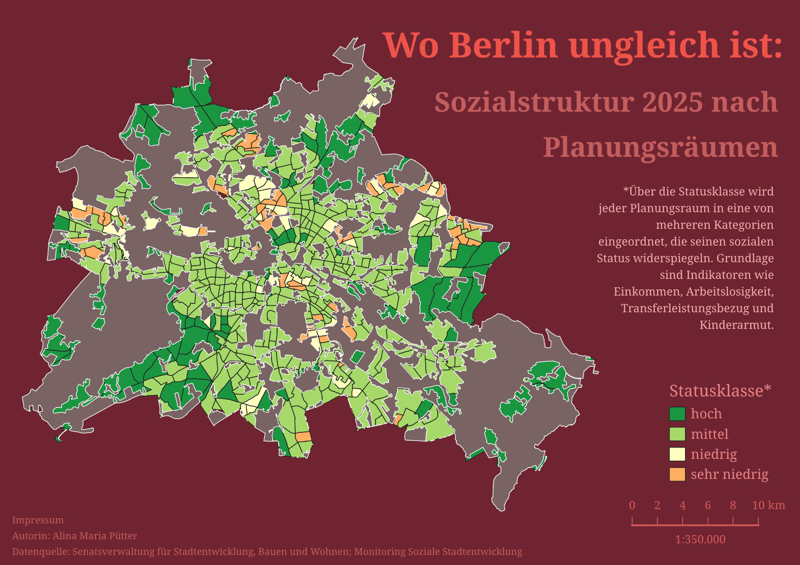
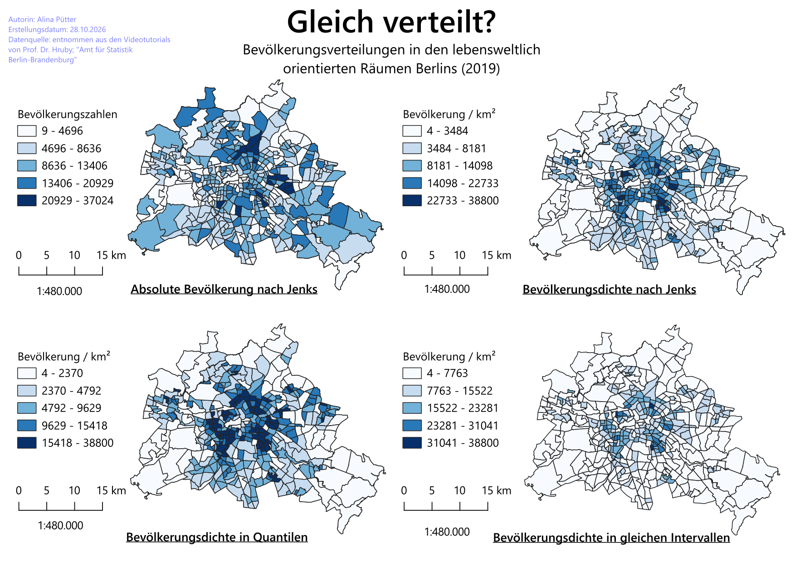

# GIS
## Einheit 0: Einführung in QGIS - Monitoring Soziale Stadtentwicklung
### Vor- und Nachteile der Methode

Die verwendete Methode ermöglicht eine mehrdimensionale Betrachtung der sozialen Struktur Berlins, da Indikatoren wie Arbeitslosigkeit, Transferleistungsbezug und Kinderarmut miteinander kombiniert werden. Daraus folgt eine besonders deutliche Darstellung der prägnant benachteiligten Gebiete Berlins.
Aber genau durch diese Kombination können Einzelinformationen, sprich, die oben genannten Indikatoren, verloren gehen. Hier ist nicht deutlich erkennbar, welcher Indikator ausschlaggebend für die Einstufung ist.

## Einheit 1: Datenklassifizierung
### Vor- und Nachteile der Methode

Ein großer Vorteil dieser vier Darstellungsweisen ist die Spezifität, je nach dem, was genau unterstrichen werden soll, was zu dem Nachteil des erhöhten Arbeitsaufwandes bei Erstellung der vier Karten führt.

**Karte A** *(oben links)* zeigt die Absolute Bevölkerungsdichte an, bedeutet, hier wird deutlich, in welchen Teilgebieten besonders viele bzw. wenige Menschen leben.
Dennoch wird die Flächengröße nicht berücksichtigt und ein verzerrtes Bild über die Einwohnerverteilung könnte entstehen.
**Karte B** *(rechts oben)* stellt genau diesen Bezug her. Durch die hier vorliegende Einteilung der Klassen können allerdings enorme Unterschiede untergehen. Wie beispielsweise innerhalb der zweiten Klasse (2484-8181 Bewohner pro km²).
**Karte C** *(links unten)* wiederum zeigt eine gleichmäßige Verteilung der Teilgebiete auf die fünf Farbklassen, wodurch eine klarere optische Unterscheidung deutlich wird. Der Nachteil hier ist, dass sehr unterschiedliche Bevölkerungsdichten derselben Klasse zugeordnet werden und die tatsächlichen Größenunterschiede nicht proportional dargestellt werden können.
**Karte D** *(rechts unten)* kann diese Größenordnung der Bevölkerungsdichte gut vergleichen, die Farbklassen werden hier auch quantitativ deutlich bedeutsamer als in Karte C. Auffällig ist hier allerdings die nicht vollständige Ausschöpfung der Farbskala wie in den Karten A bis C.

